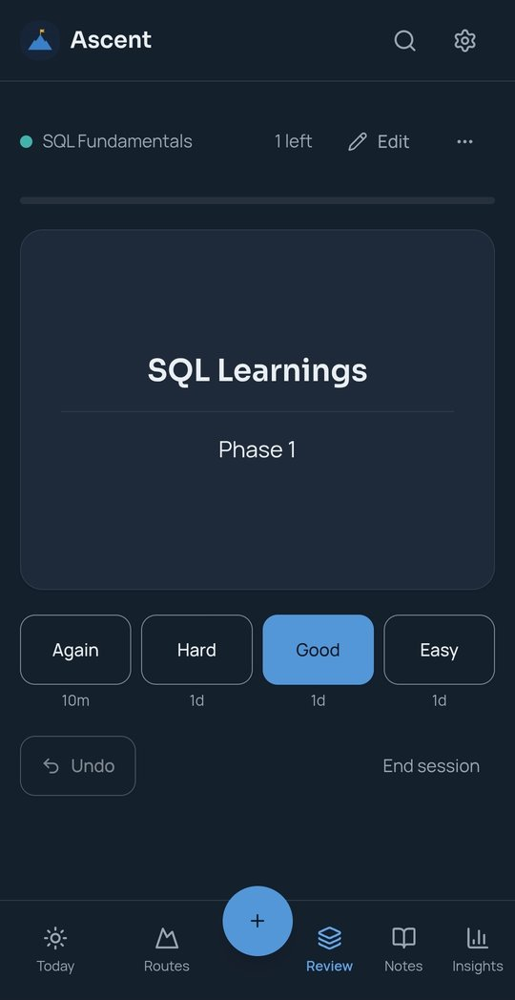
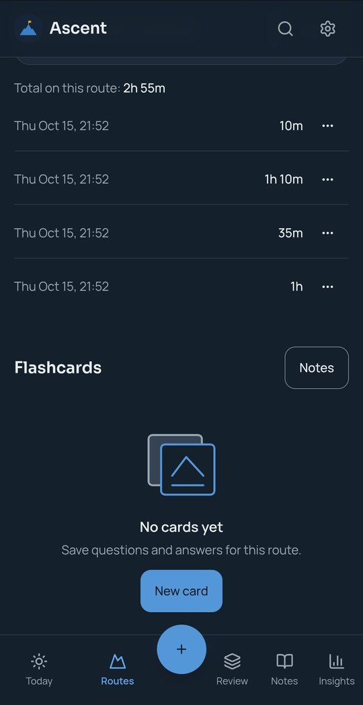
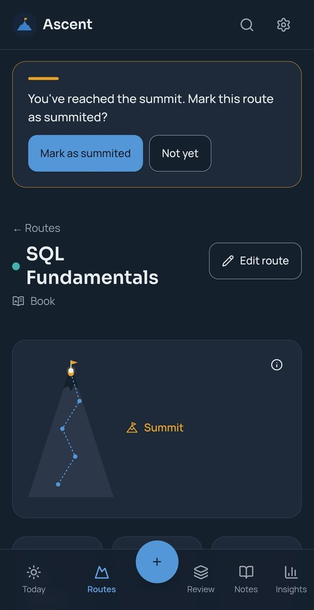

### Hi, I'm Samy 👋

Customer operations specialist with 6+ years in regulated fintech, payments and licensed gambling (Square/Block, Azimo, PokerStars). Promoted twice at Block, ending with two-plus years as EU/UK Complaints Manager. Law degree, native French and English.

**Track record:** 100% QA/CSAT · #1 in team for cross-sell · ~90 complex cases a month · SLA above 95%

I work across customer success, complaints and compliance (KYC/AML). I build working tools around one fictional fintech, **Northwind Payments**, to show how I'd run its support, complaints and risk operations end to end. Synthetic data only.

## 🧾 Northwind Payments: tools I've built

- **[Northwind Payments Support Desk](https://github.com/SamyBosvy/jira-support-desk)**: the customer support desk, built in Jira Service Management. Four request types (enquiries, technical issues, payment disputes, complaints) with tailored intake forms, SLA timers per type, escalation queues and an automated acknowledgement, tested end to end with 12 tickets.
- **Redress** *(in progress)*: complaints management for EU payment and e-money institutions, built on my work as EU/UK Complaints Manager at Block. PSD2 deadline clocks per customer country (15 business days, 35 with a holding response), a colour-coded queue and a personal "My day" view, intake by public web form in six languages or by CSV/Excel import, final responses from versioned templates with the ADR referral wording built in, four-eyes QA with random sampling, complaints MI with a regulatory reporting pack, a database-enforced audit trail, and GDPR retention and subject-access tools. Multi-tenant with row-level security; 586 automated tests passing. Next: live testing with a signed-in firm.
- **Next:** KYC Desk, a merchant case-review simulator in French (UBO structures, EDD triggers, sanctions/PEP hits, risk-rating memos), then Vitals, customer health and expansion for a merchant portfolio.

## 🎓 Certified

- **Support and AI:** Intercom Certified, *Designing and implementing a conversational framework for support teams* (Fin, 55/55) · Elements of AI (University of Helsinki) · Anthropic AI Fluency
- **Customer success:** Gainsight CS Skills (Durable Growth Playbook) · Gainsight Digital Customer Success
- **Tools and compliance:** Atlassian Jira, Jira Service Management and Confluence learning paths · GDPR (LinkedIn Learning)

## 📚 Learning now

SQL on my own app data · Salesforce Trailhead (CRM basics) · Zendesk AI · AML/KYC and the French AML framework

## 🛠️ Personal projects

Private, invite-only apps I built for myself and friends in Lovable: **[Tempo](https://focus-tempo.lovable.app)** (deep work and meeting prep from Google Calendar) · **[Ascent](https://ascenthigher.lovable.app)** (skill tracker with spaced-repetition flashcards) · **[Forge](https://forge-fueler.lovable.app)** (turns frustration into a matched task and a focus session).

<b>Ascent</b>: how it works, with screenshots

A learning tracker where each skill is a climb. I use it to run my own learning plan.

- **Routes:** each skill or project gets a target date, milestones and logged study time. Progress moves it from camp to camp, and you confirm the summit yourself.
- **Review:** Anki-style spaced-repetition flashcards (Again, Hard, Good, Easy), with undo, review-ahead and a cram mode that leaves the schedule untouched.
- **Also:** notes, habit check-ins with push reminders, insights on study hours and recall, and offline use with automatic sync. Installs on a phone like a native app.

  
  
  

📫 [LinkedIn](https://www.linkedin.com/in/samy-bosvy/)
