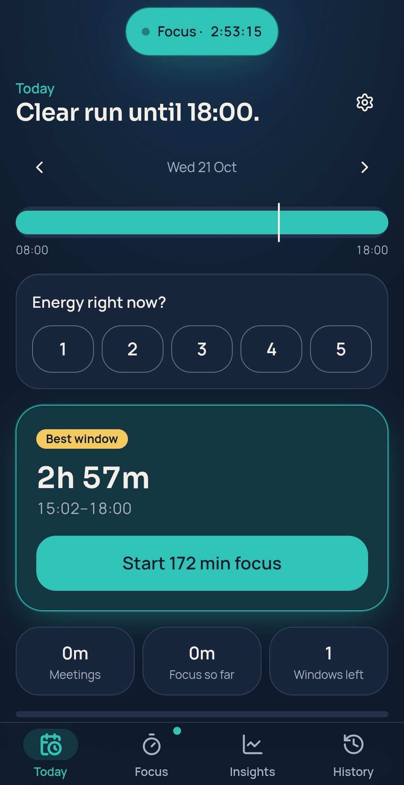
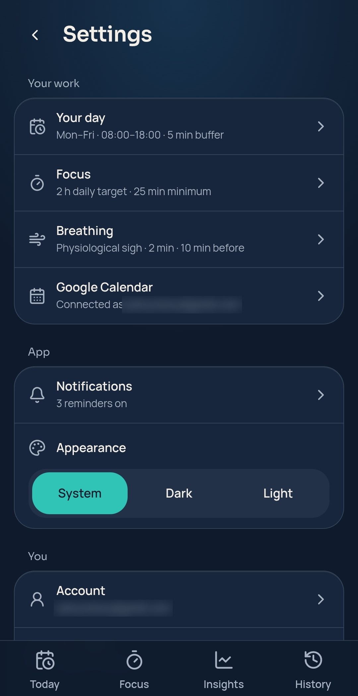
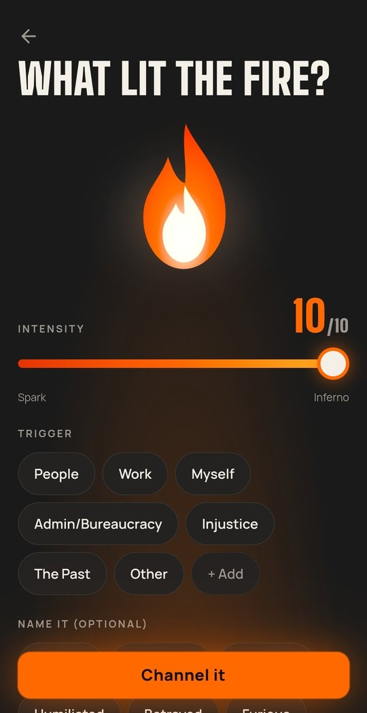

### Hi, I'm Samy 👋

Customer operations specialist with 6+ years in fintech, payments, SaaS and licensed gaming (Square/Block, PokerStars, Azimo): customer success, senior escalations and regulated complaints. Law degree, native French and English.

I'm building the technical side of support and compliance work: AI support agents, support tooling, data, and how payment systems fit together. On the side, I build apps with AI.

## 🧾 Support tools I've built

- **[Northwind Payments Support Desk](https://github.com/SamyBosvy/jira-support-desk)**: a customer support desk for a fictional fintech, built in Jira Service Management. Four request types (enquiries, technical issues, payment disputes, complaints) with tailored intake forms, SLA timers per type, escalation queues and an automated acknowledgement, tested end to end with 12 tickets.
- **Redress** *(in progress)*: a complaints-management platform for EU payment and e-money institutions, built on my experience as EU/UK Complaints Manager at Square/Block. Multi-tenant with row-level security. Built so far: complaint intake and a public web form per firm, PSD2 business-day deadline clocks per customer country (15 days, 35 with a holding response), a colour-coded queue, responses generated from templates with the ADR referral built in, a database-enforced audit trail, QA review with random sampling, a reporting dashboard with a regulatory pack, and GDPR retention and subject-access tools. Next: billing and email notifications.

## 🛠️ Apps I've built

- **[Tempo](https://focus-tempo.lovable.app)** *(private, invite-only)*: a mobile-first app for protecting deep work and handling meeting stress. It reads your Google Calendar to find focus windows and flag high-stakes meetings, prompts a short breathing session beforehand, and turns focus sessions, interruptions and energy into insights on when you work best. Reminders arrive even when the app is closed, and it installs on your phone like a native app.

  

    
    
    
  

- **[Ascent](https://ascenthigher.lovable.app)** *(private, invite-only)*: a learning tracker where each skill is a climb. Milestones, study timer, notes and habit check-ins move you from camp to summit. Includes Anki-style spaced-repetition flashcards, habit streaks with push reminders, and offline use with automatic sync. Installs on your phone like a native app.
- **[Forge](https://forge-fueler.lovable.app)** *(private, invite-only)*: a mobile-first app that turns anger into action. Log what set you off and how intense it is, and get a physical, productive or calming task matched to your state, plus a focus timer and pattern tracking.

  

    
    
    
  

## 🌱 In progress

- **Bloom**: mindfulness and meditation app with guided sessions, mood tracking and journaling

## 🎓 Certified

Fin Expert Certification, Intercom (55/55) · Atlassian: Jira, Jira Service Management and Confluence learning paths · Elements of AI · Anthropic AI Fluency

## 📚 Learning

SQL · Excel / Power Query · Power BI · Zendesk · n8n · AML / KYC

📫 [LinkedIn](https://www.linkedin.com/in/samy-bosvy/)
