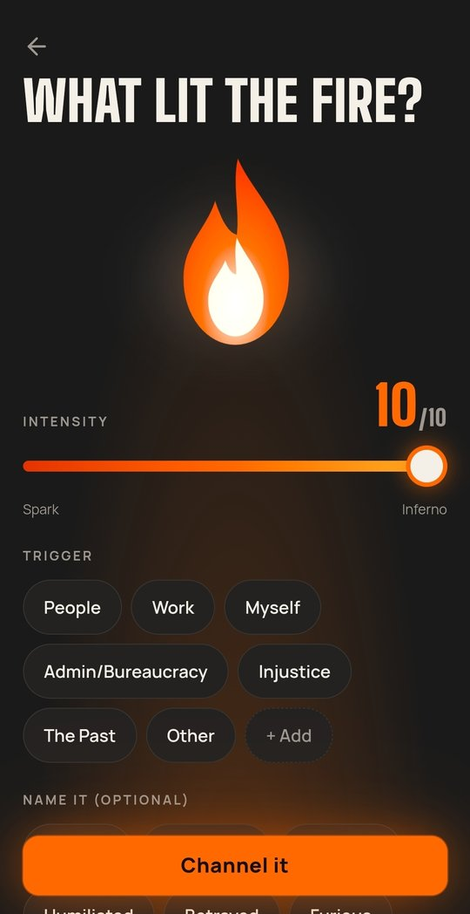
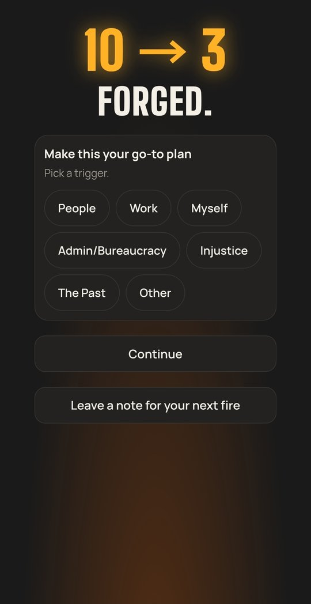
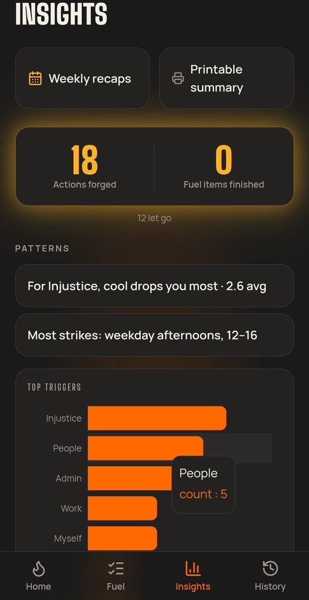

### Hi, I'm Samy 👋

Complaints and compliance specialist with 6.5 years in regulated payments, fintech and iGaming (Square/Block, Azimo, PokerStars). Law degree, native French and English.

I'm building the technical side of compliance and support work: querying data, analysing complaints trends, and understanding how payments systems fit together. On the side, I build apps with AI.

## 🛠️ Apps I've built

- **[Tempo](https://dusk-to-dawn-tempo.lovable.app)** *(private, invite-only)*: a mobile-first app for protecting deep work and handling meeting stress. It reads your Google Calendar to find focus windows and flag high-stakes meetings, prompts a short breathing session beforehand, and turns focus sessions, interruptions and energy into insights on when you work best. Reminders arrive even when the app is closed, and it installs on your phone like a native app.
- **[Ascent](https://ascenthigher.lovable.app)** *(private, invite-only)*: a learning tracker where each skill is a climb. Milestones, study timer, notes and habit check-ins move you from camp to summit. Includes Anki-style spaced-repetition flashcards, habit streaks with push reminders, and offline use with automatic sync. Installs on your phone like a native app.
- **[Forge](https://forge-fueler.lovable.app)** *(private, invite-only)*: a mobile-first app that turns anger into action. Log what set you off and how intense it is, and get a physical, productive or calming task matched to your state, plus a focus timer and pattern tracking.

  

    
    
    
  

## 🌱 In progress

- **Bloom**: mindfulness and meditation app with guided sessions, mood tracking and journaling

## 📚 Learning

SQL · Excel · Power BI · APIs (Postman) · Jira Service Management · payments infrastructure · generative AI (working towards Google Cloud Generative AI Leader)

📍 Based in Australia, returning to Europe · 📫 [LinkedIn](https://www.linkedin.com/in/samy-bosvy/)
